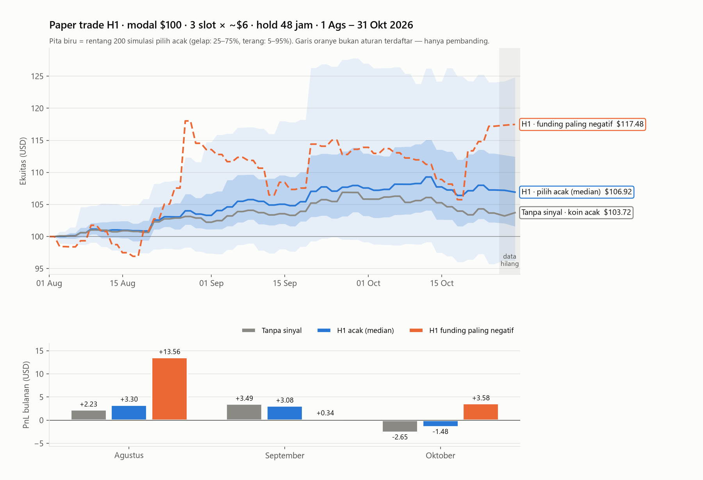

# Laporan Uji Forward H1 — Funding Carry

**Tanggal laporan:** 8 November 2026
**Periode uji:** 1 Agustus – 31 Oktober 2026 (data yang belum pernah dilihat)
**Repo:** `C:\Crypto data 2` → github.com/daijobudesu69/Crypto-Funding-Strategy
**Commit:** `6b15c0b` (uji forward), `636d3f7` (simulasi paper trade)
**Revisi 8 Nov 2026 (sore):** ditambah pembanding dengan FCL dan hipotesis baru
**H3** (§11), opsi tambahan untuk bot FCL. Spesifikasi lengkap H3: [`H3_SPEC_FCL.md`](../../H3_SPEC_FCL.md).

---

## 1. Ringkasan

| | |
|---|---|
| **Vonis** | **LULUS** |
| Kriteria (dikunci 23 Agustus 2026) | mean net > 0 **dan** t clustered per tanggal > 2,0 |
| Mean net per observasi | **+1,058%** |
| t clustered per tanggal | **+2,76** (p = 0,007) |
| CI 95% | [+0,296%, +1,821%] |
| n observasi | 4.162 (87 hari, 547 symbol) |
| Paper trade 3 bulan, modal $100 (median) | **+$6,92** (koin acak tanpa sinyal: +$3,72) |

**Langkah berikutnya:** paper trading 60 hari. Yang diukur adalah **selisih fill
dibanding sinyal**, bukan P&L. H1 **belum boleh dipakai live**.

**Tambahan: H3 (opsi untuk FCL, tidak wajib).** H3 = H1 yang dibatasi ke 91 koin
bot FCL, dengan biaya HYPE. Dikunci 8 November 2026, diuji di data November 2026 –
Januari 2027. **Tidak boleh live di FCL** tanpa data terbaru dari Dew, uji ulang
dengan data itu, dan approval eksplisit Dew. Detail di §11.

Dua hal yang perlu diwaspadai:

1. **Hasilnya bergantung pada sedikit trade besar.** Median per observasi −0,03%,
   dan hanya 49,4% observasi yang untung. Lima symbol menyumbang 37,6% total P&L.
2. **Oktober nyaris nol** (+0,20%, t 0,32). Di dalam periode forward sendiri,
   hasilnya menurun dari bulan ke bulan.

---

## 2. Latar belakang

H1 ditemukan lewat pencarian post-hoc di panel 1 Agustus 2024 – 31 Juli 2026:
14 run ablation, lalu dua kandidat yang nyaris lolos, lalu irisan keduanya.
Karena aturannya dipilih dari data itu sendiri, hasil in-sample **bukan bukti**.
Aturan ini dikunci di `HYPOTHESIS_REGISTER.md` pada 23 Agustus 2026, sebelum
data Agustus–Oktober 2026 terbit.

Uji forward ini adalah satu-satunya uji yang tidak bisa dicurangi, dan **hanya
bisa dipakai sekali**. Kriteria lulus/gagal ditetapkan sebelum angka dilihat.
Hanya ada dua jalan:

- **Lulus** → lanjut ke paper trading 60 hari.
- **Gagal** → strategi funding ditutup, lalu pindah ke lapisan positioning Gate.io.

---

## 3. Definisi H1 (disalin persis, tidak ada yang diubah)

```
Tiap tanggal d pukul 00:00 UTC, untuk tiap perp USDT Binance USDS-M
dengan >=30 hari riwayat klines:

  funding_24h_sum = jumlah funding rate dalam (d-1 00:00, d 00:00]
  funding_ts_z30  = (funding_24h_sum - mean30) / std30   (riwayat symbol sendiri)
  zrank           = peringkat persentil funding_ts_z30 antar symbol eligible pada d

  SINYAL LONG bila:  funding_24h_sum <= 0  DAN  zrank <= 0.20

  Entry  : open bar 1H pada d 00:00 UTC
  Exit   : open bar 1H 48 jam kemudian. TANPA stop, TANPA target.
  Sizing : notional $6.00 fixed, equal-weight
  Biaya  : fee maker 0.02% x 2 (= 0.04% round trip) + funding aktual selama hold
  Filter : hanya symbol dengan executable_100usd == True
```

Net return per observasi = `fwd_48h − 0,04% − funding_paid_48h`.
Untuk posisi long, funding negatif berarti uang **diterima**.

---

## 4. Data dan metode

### 4.1 Sumber data

- **Klines 1H dan fundingRate:** arsip `data.binance.vision`.
  - Juni–Oktober 2026 dalam file bulanan (Juni–Juli sebagai warmup z-score 30 hari).
  - 1–5 November 2026 dalam file harian, untuk exit sinyal di akhir Oktober.
- **Universe:** semua perp USDT yang pernah ada di arsip, termasuk yang sudah delisted.
  - 749 symbol punya data di window ini.
  - Rata-rata 685 symbol eligible per hari.
- **Download:** 13.845 file (9.277 baru, 2.894 dari cache, 1.674 tidak ada di arsip, 0 gagal).
- **Arsip funding Oktober** sudah dicek terbit (HTTP 200) sebelum uji dijalankan.

### 4.2 Pipeline

Skrip: `src/h1_forward.py`. Pipeline-nya sama dengan in-sample
(`fetch.py` → `features.py` → `panel.py` → `stats.py`). Periode di-override di
memori saja: `config.py` tidak diubah, dan panel in-sample tidak disentuh.

- **Grouping tanggal** memakai `pd.factorize`. Ini menghindari bug pandas 3.0
  yang dulu merusak ranking cross-sectional.
- **zrank** dihitung di antara semua symbol eligible, sesuai teks definisi.
  Baru setelah itu sinyal disaring `executable_100usd`.
- **Funding hold** dihitung pada window (d 00:00, d+48 jam], yaitu sampai jam
  keluar sebenarnya.
- **Klines nol-volume** di ekor seri (perp delisted yang arsipnya tetap terbit)
  dibuang. Ini mengenai 133 symbol. Baris dengan `dollar_vol_24h == 0` tidak eligible.

### 4.3 Inferensi

- Standard error di-cluster per tanggal (`stats.cluster_mean`). Altcoin bergerak
  bersama, jadi observasi di hari yang sama tidak independen.
- CI pembanding: bootstrap dengan resampling tanggal (`stats.cluster_bootstrap_ci`,
  2.000 replikasi, seed 20260823).

---

## 5. Hasil

### 5.1 Angka utama

| Ukuran | Nilai |
|---|---:|
| n observasi | 4.162 |
| Hari dengan sinyal | 87 |
| Sinyal per hari (rata-rata) | 47,8 |
| **Mean net** | **+1,058%** |
| SE (cluster tanggal) | 0,384% |
| **t clustered** | **+2,76** |
| p | 0,007 |
| CI 95% (t) | [+0,296%, +1,821%] |
| CI 95% (bootstrap tanggal) | [+0,336%, +1,836%] |
| Komponen harga setelah fee | +0,714% |
| Komponen funding yang diterima | +0,345% |

**Vonis terhadap kriteria: LULUS.** Mean +1,058% > 0, dan t 2,76 > 2,0.

### 5.2 Per bulan

| Bulan | n | Hari | Mean net | t |
|---|---:|---:|---:|---:|
| Agustus 2026 | 1.517 | 31 | +1,578% | 2,70 |
| September 2026 | 1.355 | 30 | +1,292% | 1,67 |
| Oktober 2026 | 1.290 | 26 | **+0,202%** | **0,32** |

### 5.3 Konteks pasar

| | Mean net | t |
|---|---:|---:|
| Seluruh universe executable (semua koin, tanpa sinyal) | +0,566% | — |
| Spread H1 dibanding sisa universe executable | +0,535% | 1,94 |

Pasar naik selama periode uji. Sekitar setengah return H1 adalah ikut naiknya
pasar. Keunggulan relatif H1 dibanding koin lain hanya +0,54%, dan itu sendiri
tidak signifikan (t 1,94).

### 5.4 Distribusi return per observasi

| Statistik | Nilai |
|---|---:|
| Minimum | −53,2% |
| Kuartil 1 | −3,21% |
| **Median** | **−0,03%** |
| Kuartil 3 | +3,35% |
| Maksimum | +465,2% |
| Simpangan baku | 13,4% |
| Persentase observasi untung | 49,4% |

---

## 6. Dibanding hasil sebelumnya

| Tahap | Mean net | t |
|---|---:|---:|
| In-sample (Ags 2024 – Jul 2026) | +0,536% | 2,30 |
| Walk-forward OOS gabungan | +0,634% | 2,13 |
| **Uji forward (Ags – Okt 2026)** | **+1,058%** | **2,76** |

### Apakah peluruhan berlanjut?

| Periode | Mean net |
|---|---:|
| In-sample tahun 1 | +0,901% |
| In-sample paruh 2 | +0,236% |
| Fold walk-forward terakhir (Jun – Jul 2026) | +0,053% |
| Forward Agustus | +1,578% |
| Forward September | +1,292% |
| Forward Oktober | +0,202% |

**Kalau dilihat agregat, tidak.** Hasil forward jauh di atas fold terakhir.
**Tapi di dalam periode forward, polanya muncul lagi:** Agustus → September →
Oktober terus turun, dan Oktober kembali mendekati nol. Belum bisa dipastikan
apakah ini edge yang hidup kembali, atau dua bulan yang kebetulan banyak short
squeeze. Paper trading akan menambah data untuk menjawabnya.

---

## 7. Pemeriksaan bug

Aturan repo: hasil yang berlawanan dengan hasil sebelumnya dianggap bug sampai
terbukti tidak. Di sini hasil forward berlawanan dengan tren peluruhan, jadi
diperiksa dengan empat cara:

| Pemeriksaan | Hasil |
|---|---|
| Hitung ulang manual 3 baris acak langsung dari ZIP mentah (`funding_24h_sum`, `fwd_48h`, funding dibayar, zrank) | Cocok persis sampai digit terakhir |
| Kode forward dijalankan pada panel in-sample | +0,527% (t 2,26), tercatat +0,536% (t 2,30) → pipeline konsisten |
| Grouping tanggal | `pd.factorize`, bukan `astype(int64) // 10**9` |
| Kontributor terbesar (LSK, SKR, ONG, ONE, RLC) dicek di data 1H | Pump nyata: volume puluhan sampai ratusan juta USD per jam, funding sangat negatif (short squeeze). Bukan artefak arsip |

Contoh: LSKUSDT, sinyal 12 September 2026. Entry 0,14066, lalu naik ke 0,779
dalam 48 jam (+454%), dengan funding −11,1% yang dibayarkan ke posisi long.

**Kesimpulan: tidak ditemukan bug.**

---

## 8. Ketahanan dan keterbatasan

### 8.1 Bergantung pada sedikit trade besar

| Varian (hanya pemeriksaan, bukan aturan baru) | Mean net | t |
|---|---:|---:|
| Utama | +1,058% | 2,76 |
| Return dipangkas di persentil 1% dan 99% | +0,663% | 1,92 |
| Tanpa 5 symbol penyumbang terbesar | +0,673% | 1,93 |
| Rata-rata per hari | +1,076% | — |
| Median per hari | +0,777% | — |
| Hari yang positif | 57,5% | — |

Begitu trade-trade terbesar diredam, t turun ke bawah 2. Vonis tetap **LULUS**,
karena kriterianya sudah ditetapkan sebelumnya. Tapi artinya, keuntungan H1
datang dari menangkap pump besar yang jarang, bukan dari untung kecil yang
konsisten.

Symbol dengan kerugian total terbesar: IOSTUSDT −85,4%, KAITOUSDT −84,8%,
WUSDT −72,7%, 龙虾USDT −56,6%, BULLAUSDT −54,6% (jumlah return semua sinyalnya).

### 8.2 Celah data

| Masalah | Penyebab | Dampak |
|---|---|---|
| **28 Oktober 2026 tidak ada di arsip** | File bulanan Oktober hanya punya 720 dari 744 jam. Checksum resmi cocok, file harian 404. Kesalahan ada di sisi penerbit arsip | Sinyal 26 Okt (exit hilang), 28 dan 29 Okt (entry/fitur hilang) tidak bisa dihitung |
| Funding 30–31 Oktober tidak lengkap | Arsip funding November belum terbit, dan `fapi.binance.com` tidak bisa diakses dari mesin ini | 140 sinyal tanpa biaya funding |
| Label hilang untuk 3 sinyal lain | 25–26 Ags dan 23 Okt, masing-masing 1 symbol | Diabaikan |

Total **228 sinyal tanpa label dibuang**.

Sensitivitas: kalau exit 26 Oktober ditambal dengan close 27 Okt 23:00, hasilnya
+1,039% (t 2,76). Vonis tidak berubah.

### 8.3 Kekhawatiran lama yang belum terjawab

- **Aturan pemilihan belum ditentukan.** Sinyal ada ~48 per hari, sedangkan
  kapasitas cuma 3 slot. Karena keuntungan bergantung pada trade besar, cara
  memilih 3 dari 48 akan sangat menentukan hasil nyata. Setiap aturan pemilihan
  baru adalah derajat bebas baru: harus didaftarkan dulu, baru diuji di data baru.
- **Bonferroni** hanya mengoreksi jumlah uji, bukan proses pemilihan aturan.

---

## 9. Simulasi paper trade 3 bulan



### 9.1 Aturan simulasi

Mengikuti `src/portfolio.py` apa adanya:

- Modal awal $100.
- Margin 3% dari **ekuitas berjalan** × leverage 2 (sekitar $6 per posisi).
- Paling banyak 3 posisi terbuka bersamaan, hold 48 jam, tanpa stop.
- Gate stepSize dievaluasi pada notional berjalan.
- Biaya 0,04% plus funding aktual.

Aturan memilih di antara ~48 kandidat belum ditentukan, jadi skenario utamanya
**pilih acak**, diulang 200 kali dengan seed berbeda.

### 9.2 Hasil

| Skenario | Ekuitas akhir | PnL | Trade | Kena | Drawdown maks |
|---|---:|---:|---:|---:|---:|
| **H1, pilih acak (median 200 simulasi)** | **$106,92** | **+$6,92** | 132 | 48,5% | −4,3% |
| ↳ persentil 5% terburuk | — | −$3,81 | | | |
| ↳ persentil 95% terbaik | — | +$24,86 | | | |
| Tanpa sinyal, koin acak (pembanding) | $103,72 | +$3,72 | | | |
| H1, funding paling negatif dulu * | $117,48 | +$17,48 | 132 | 45,5% | −10,4% |

\* **Bukan aturan yang terdaftar.** Ditampilkan hanya sebagai pembanding, dan
tidak boleh dijadikan bukti.

- H1 pilih acak berakhir untung di **83%** simulasi.
- Tambahan dari sinyal H1 dibanding koin acak sekitar **+$3,20 dalam 3 bulan**.

### 9.3 PnL per bulan (USD)

| Bulan | H1 acak (p5 / median / p95) | Tanpa sinyal (median) | H1 funding paling negatif |
|---|---|---:|---:|
| Agustus | −2,63 / **+3,30** / +14,72 | +2,23 | +13,56 |
| September | −2,07 / **+3,08** / +13,25 | +3,49 | +0,34 |
| Oktober | −5,97 / **−1,48** / +5,78 | −2,65 | +3,58 |

### 9.4 Cara membaca

- Pita biru yang lebar menunjukkan peran keberuntungan: apakah pump besar
  kebetulan masuk ke 3 slot atau tidak. Hanya ada 11 sinyal dengan net di atas
  +100% selama 3 bulan.
- Ini simulasi dari data historis. Fill, slippage, dan antrean order limit
  belum diukur. Itulah tujuan paper trading 60 hari.
- Area abu-abu di grafik (26–31 Oktober) adalah periode data hilang. Tidak ada
  posisi baru yang dibuka di sana.

---

## 10. Status logger positioning Gate.io (Stage 0)

| | |
|---|---|
| Status | **Masih berjalan** lewat GitHub Actions (`stage0-logger.yml`) |
| Jadwal | cron 01:20 UTC; dalam praktik GitHub menjalankannya sekitar 07:00–08:00 UTC |
| Cakupan | 76 hari, 23 Agustus – 7 November 2026 |
| Run terakhir yang berhasil | 7 November 2026 |
| Keandalan | 59 berhasil, 1 gagal (60 run terakhir) |
| Hari bolong | **26 Oktober 2026** (run gagal; log GitHub sudah kedaluwarsa, penyebab tidak diketahui) |

Data ini adalah bahan untuk lapisan positioning, arah riset berikutnya yang
belum pernah diuji. Hari 26 Oktober mungkin bisa ditambal dari riwayat API
Gate.io. Itu perlu dicek sebelum lapisan ini diuji.

---

## 11. Pembanding dengan FCL dan lahirnya H3

### 11.1 Apa itu FCL

FCL (Funding-Crowding Long/Short, repo `Crypto-FCL`) adalah bot paper yang
sudah berjalan sejak 24 Oktober 2026:

- **Short** koin dengan funding Binance 14 hari tertinggi, **long** yang terendah.
- Dollar-neutral, 91 koin yang ada di HYPE, rebalance harian 08:20 UTC, eksekusi di HYPE.
- Forward Jan 2025 – Okt 2026: $200 → $373 (Sharpe 2,33). Audit memotong ekspektasinya ke Sharpe 1–1,5.
- Paper per 8 Nov 2026: $198,36 (DD −2,6%). Baru 2 minggu, belum bisa dinilai.

Temuan riset FCL sendiri yang relevan:
- **Carry murni lemah sebagai alpha.** Memilih koin ber-funding tinggi untuk cash-and-carry merusak nilai.
- **Yang stabil:** cash-and-carry BTC+ETH yang selalu jalan (~12%/tahun atas modal). Ini premi carry pasar, bukan alpha, dan risikonya ada di ekor (kolaps bursa, depeg, margin call).
- **Edge FCL ada di sisi short.** Sisi long hampir tidak bernilai sejak 2022.

### 11.2 Kenapa H1 cocok jadi pendamping FCL

H1 adalah strategi **long** pada koin yang funding-nya baru saja jatuh. Ini
mengisi sisi FCL yang lemah, dengan sinyal yang berbeda: lonjakan 24 jam
(z-score), bukan level 14 hari.

- **Korelasi harian H1 vs FCL: −0,07** (63 hari tumpang tindih, 1 Ags – 2 Okt 2026). Praktis tidak berkorelasi.
- **H1 kalau dibatasi ke koin FCL** (zrank masih dihitung di seluruh perp Binance):
  754 trade, +1,70% (t 2,38), median +0,15%, ~8,7 sinyal per hari.

### 11.3 H3 — definisi yang bisa dijalankan di FCL

Bot FCL hanya punya data funding untuk 91 koinnya, bukan untuk ~685 perp Binance.
Karena itu H3 dikunci dengan **zrank dihitung di antara 91 koin itu saja**.

| | H1 | **H3** |
|---|---|---|
| Universe | Semua perp USDT Binance (~685 eligible/hari) | **91 koin beku** (`results/h3/coins_h3_frozen.csv`) |
| zrank dihitung di antara | Semua perp Binance eligible | **91 koin H3 yang eligible** |
| Sinyal | funding 24j ≤ 0 dan zrank ≤ 0,20 | sama |
| Hold | 48 jam, tanpa stop/target | sama |
| Biaya | 0,04% pulang-pergi (maker) | **0,13% pulang-pergi** (HYPE 0,065%/sisi) |
| Filter executable | `executable_100usd` (stepSize Binance) | tidak ada (sizing HYPE) |

Angka post-hoc untuk definisi persis H3 di periode Agustus–Oktober 2026
(**bukan bukti**, karena irisannya dipilih setelah melihat data ini):

| Ukuran | Nilai |
|---|---|
| n / sinyal per hari | 774 / 8,9 |
| Mean net | +1,44% (t 2,20), CI [+0,14%, +2,74%] |
| Median / trade untung | −0,02% / 49,6% |
| Dipangkas di persentil 1%/99% | +1,35% (t 2,16) |
| Agustus / September / **Oktober** | +2,75% / +2,41% / **−0,98%** |
| 5 koin teratas | 46,7% dari total P&L |

Angka ini direproduksi persis oleh `src/h3_forward.py`
(`results/h3/check_2026-08-01_2026-10-31/`).

### 11.4 Uji yang menentukan

- **Periode:** 1 November 2026 – 31 Januari 2027. Dijalankan setelah arsip
  funding Januari 2027 terbit (± 8 Februari 2027).
- **Lulus bila:** mean net > 0 **dan** t clustered per tanggal > 2,0.
- **Gagal:** H3 ditutup. Ambang, horizon, dan daftar koin tidak boleh disetel lalu diuji ulang.

### 11.5 ⛔ Aturan gerbang live H3 (ditetapkan Dew)

H3 adalah **opsi tambahan, tidak wajib** untuk FCL. **H3 tidak boleh dijalankan
sebagai live trade di FCL** sebelum ketiga syarat ini terpenuhi:

1. **Minta data terbaru ke Dew.** Tidak boleh memakai data lama atau data di laporan ini.
2. **Uji ulang H3 dengan data baru itu** dan laporkan hasilnya ke Dew.
3. **Approval eksplisit Dew** setelah melihat hasil itu.

Tanpa ketiganya, H3 tetap mati (`enabled: false`), atau paling jauh `paper`.
`src/h3_forward.py` menolak jalan tanpa flag `--dew-data-ok`.

Penjelasan cara kerja, contoh, sumber data di bot FCL, konfigurasi, pseudocode,
dan checklist pemasangan ada di [`H3_SPEC_FCL.md`](../../H3_SPEC_FCL.md).

---

## 12. Langkah berikutnya

1. **Paper trading 60 hari.** Ukur selisih fill dibanding sinyal (harga entry
   dan exit, fill rate order limit, slippage), bukan P&L.
2. **Daftarkan aturan pemilihan sebelum paper trading dimulai.** Contohnya:
   acak, atau funding paling negatif. Aturan itu wajib dicatat di
   `HYPOTHESIS_REGISTER.md` sebagai entri baru, dan tidak boleh dipilih
   berdasarkan grafik di §9.
3. **Ulangi uji untuk 30–31 Oktober** setelah arsip funding November terbit
   (sekitar 7 Desember 2026). Hanya untuk melengkapi data, bukan untuk mengubah vonis.
4. **Jangan setel ambang apa pun.** Uji forward ini sudah terpakai.
5. **H3 (opsional, untuk FCL):** pasang modul dengan `enabled: false`, parity check,
   opsional paper. Uji forward Nov 2026 – Jan 2027 sekitar 8 Februari 2027,
   **setelah meminta data terbaru ke Dew**. Live hanya dengan **approval eksplisit Dew**.

---

## 13. File terkait

| File | Isi |
|---|---|
| `HYPOTHESIS_REGISTER.md` | Entri H1, termasuk hasil uji forward |
| `src/h1_forward.py` | Uji forward (fetch, build, uji statistik) |
| `src/h1_forward_paper.py` | Simulasi paper trade |
| `src/h1_forward_chart.py` | Grafik |
| `results/h1_forward/result.json` | Angka hasil uji lengkap |
| `results/h1_forward/signals.csv` | 4.162 sinyal beserta return net |
| `results/h1_forward/fetch_log.json` | Log download |
| `results/h1_forward/paper_equity.csv` | Kurva ekuitas (median, pita persentil) |
| `results/h1_forward/paper_monthly_*.csv` | PnL bulanan per seed |
| `results/h1_forward/paper_trades_min_funding.csv` | Trade skenario pembanding |
| `results/h1_forward/paper_trade_3bulan.png` | Grafik |
| `H3_SPEC_FCL.md` | **Spesifikasi + panduan pemasangan H3 di FCL**, termasuk aturan gerbang live |
| `src/h3_forward.py` | Uji forward H3 (butuh `--dew-data-ok`) |
| `results/h3/coins_h3_frozen.csv` | Daftar 91 koin H3 yang dibekukan |
| `results/h3/check_2026-08-01_2026-10-31/` | Angka post-hoc H3 Ags–Okt (bukan uji resmi) |

*Tidak ada trade nyata yang dijalankan. Repo Crypto-Hold-14d tidak disentuh.*
